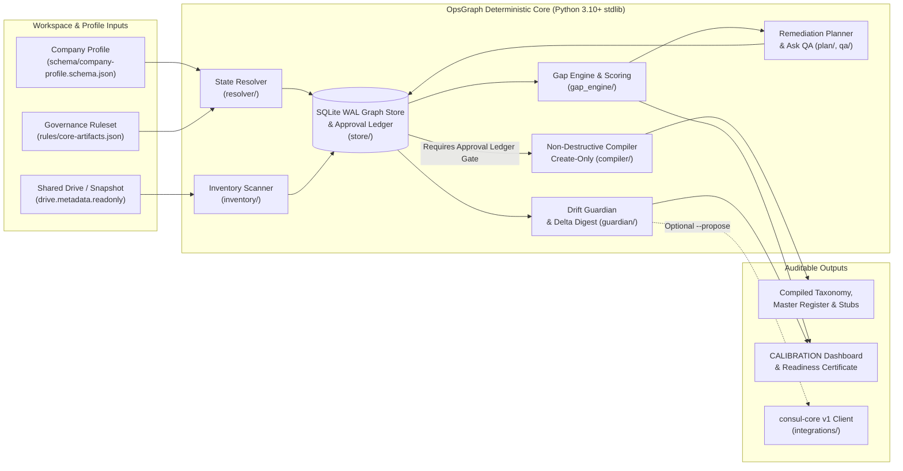

# OpsGraph

[](https://github.com/creova-gif/opsgraph/actions/workflows/ci.yml)
[](LICENSE)


Deterministic operational graph and governance compiler that turns a startup's existing Google Workspace or repository tree into an auditable company operating system. Required state (what should exist) is resolved from a company profile, compared against observed workspace metadata, and compiled into non-destructive remediation plans with SQLite WAL auditability and continuous drift monitoring.

**v1 scope:** Seed to Series A B2B tech startups (5–50 people) on Google Workspace, built for urgent operational triggers (enterprise security review, SOC 2 readiness, fundraise diligence, rapid hiring).

Core loop: `Company Profile -> Required State -> Workspace Inventory -> Gap Report -> Compile (approved) -> Guardian`

---

## System Architecture



---

## Install

Requires Python 3.10 or newer. The core engine has **zero third-party runtime dependencies**; the Google Drive live scanner is an optional extra.

```bash
git clone https://github.com/creova-gif/opsgraph.git
cd opsgraph
python -m venv .venv && source .venv/bin/activate
pip install -e .            # core CLI (works fully offline)
pip install -e ".[drive]"   # optional: real Google Drive scanning
```

## Quick start

First number in four commands (works fully offline):

```bash
opsgraph init --name "Acme Cloud Technologies, Inc." --domain acmecloud.io \
  --stage seed --headcount 14 --output profile.json --save
opsgraph scan --snapshot examples/sample-drive-inventory.json \
  --company-id acmecloud-io --record
opsgraph dashboard --company-id acmecloud-io --output dashboard.html
opsgraph status acmecloud-io
```

---

## Implementation Status

| Subsystem | Status | Notes |
| :--- | :--- | :--- |
| **State Resolver (`resolver/`)** | `Implemented & Verified` | Evaluates company profile against 31 governed artifacts (`rules/core-artifacts.json`) in topological order |
| **Workspace Inventory Scanner (`inventory/`)** | `Implemented & Verified` | Local trees, JSON snapshots, and live Google Drive API (`drive.metadata.readonly` + incremental `changes.list`) |
| **SQLite WAL Store & Approval Ledger (`store/`)** | `Implemented & Verified` | Versioned profiles, immutable run history, and append-only approval ledger with schema validation |
| **Gap Analysis Engine (`gap_engine/`)** | `Implemented & Verified` | Required-vs-observed diff, domain scorecards, and 0–100% Infrastructure Readiness Score |
| **Non-Destructive Compiler (`compiler/`)** | `Implemented & Verified` | Create-only folder taxonomy, versioned `CO-001` Master Register (CSV/JSON), template stubs, and Drive apply reversal manifest |
| **Drift Guardian & Delta Digest (`guardian/`)** | `Implemented & Verified` | Policy staleness, unapproved drift, duplicate collisions, and run-over-run digest delta |
| **Remediation Planner & Ask Floor (`plan/`, `qa/`)** | `Implemented & Verified` | P0–P3 dependency-ordered remediation plans (`--from-plan`) and grounded Q&A with citations |
| **Dashboard & Readiness Certificate (`dashboard/`, `certificate/`)** | `Implemented & Verified` | Single-file CALIBRATION HTML report, preview server, and readiness certificate generator |
| **Consul Agent Integration (`integrations/`)** | `Deterministic Simulator / Offline Fallback` | `HTTPConsulClient` implements the `consul-core` v1 contract with `StubConsulClient` offline simulation fallback |

---

## Engineering Decisions

Full rationale and trade-off analysis are documented in [ADR 0001: Zero-Dependency Python Core, SQLite WAL Persistence, and Non-Destructive v1 Compiler](docs/adr/0001-sqlite-wal-and-non-destructive-compiler.md).

1. **Zero-Dependency Python Standard Library Core:**
   - The entire core pipeline (`resolver`, `inventory`, `gap_engine`, `compiler`, `guardian`, `plan`, `qa`, `dashboard`, `certificate`, `store`) relies exclusively on the Python 3.10+ standard library.
   - **Why:** Eliminates supply-chain bloat, guarantees deterministic offline execution in CI and air-gapped environments, and keeps optional Google Drive OAuth dependencies strictly isolated in `.[drive]`.
2. **SQLite WAL Graph & Audit Store (`store/store.py`):**
   - Operational state is persisted in a local SQLite database with Write-Ahead Logging (`PRAGMA journal_mode=WAL`) and foreign keys enforced (`PRAGMA foreign_keys=ON`).
   - **Why:** Provides ACID transactions, append-only audit trails for every scan/gap/apply run, and an immutable approval ledger without requiring external database containers during concierge onboarding.
3. **Non-Destructive v1 Compilation (`delete` Prohibited by Protocol):**
   - `DriveWriteBackend` (`compiler/drive_apply.py`) exposes only `create_folder` and `create_file`. There are no `delete`, `trash`, `move`, or `overwrite` methods in v1.
   - **Why:** Enterprise and startup operators require a hard structural guarantee that connecting OpsGraph cannot destroy or overwrite existing legal, HR, or security documents. Pre-existing targets are logged as `skip`, and every created object ID (`new_id`) is recorded for deterministic reversal (`docs/engineering/APPLY_REVERSIBILITY.md`).
4. **Metadata-Only Read Boundary (`drive.metadata.readonly`):**
   - Inventory scans inspect file metadata (names, paths, MIME types, timestamps, owners) without downloading document bodies or transmitting workspace content to external LLMs. See [SECURITY.md](SECURITY.md).

---

## Layout
- `resolver/` - deterministic state resolver engine (Python) + test suite
- `inventory/` - read-only workspace metadata scanner: local trees, JSON snapshots, and real Google Drive via `scan --drive` (read-only `drive.metadata.readonly` scope; optional `[drive]` extra; incremental scans via `--state` file + `changes.list` tokens)
- `store/` - SQLite (WAL) persistence: versioned, schema-validated profiles (`profile save|list|show`), engine-run history (`--record` + `history`), an approval decision ledger (`approve`/`approvals`), and a whole-loop summary (`status`)
- `gap_engine/` - required-vs-observed gap analysis engine & infrastructure scoring
- `compiler/` - workspace compiler: creates folder taxonomy, Master Register, and governed templates
- `guardian/` - company guardian: weekly drift monitoring, policy staleness, and health digest; `--propose` emits remediation proposals per drift event via consul-core
- `integrations/` - consul-core v1 client seam: HTTP client (bearer token, `OPSGRAPH_CONSUL_TOKEN`) + deterministic local simulation fallback
- `dashboard/` - interactive visual HTML dashboard & local preview server
- `certificate/` - CALIBRATION readiness certificate renderer
- `plan/` - dependency-ordered P0–P3 remediation planner
- `qa/` - deterministic Ask Company Q&A engine grounded in gap/guardian state
- `onboarding/` - schema-valid company profile initializer (`opsgraph init`)
- `docs/adr/` - Architecture Decision Records (`0001-sqlite-wal-and-non-destructive-compiler.md`)
- `docs/architecture/` - OpsGraph–Consul integration contract (`consul-core` v1 surface)
- `docs/engineering/` - apply reversibility specification and implementation roadmap
- `docs/pilot/` - concierge pilot offer one-pager, 20-step delivery checklist, intake form
- `docs/strategy/` - viability brief, execution blueprint, YC playbook (text sources)
- `schema/company-profile.schema.json` - onboarding output (P0)
- `rules/core-artifacts.json` - Operating Graph node ruleset (JSON is the single canonical source), 31 governed artifacts + placement policy (v0.3)
- `examples/` - sample profiles & drive inventories for testing (Seed, Pre-seed, Series A)

## Principles
Specific before broad - evidence before assertion - propose before destructive action - compile, don't
dump templates - never claim compliance. Delete is never allowed in v1.

## Backlog & Execution Status
- [x] **Resolver (P0):** Profile + rules -> required artifact list with reasons and topological order (`resolver/`)
- [x] **Drive Inventory (P1):** Read-only metadata scanner — real Google Drive API (OAuth installed-app or service account, `drive.metadata.readonly`), JSON snapshots & local trees (`inventory/`)
- [x] **Gap Analysis Engine (P1):** Required vs observed diff, domain scorecards, and 0-100% Infrastructure Score (`gap_engine/`)
- [x] **Workspace Compiler Prototype (P1):** Dry-run preview, folder taxonomy, versioned Master Register (register + row versions, provenance) and template stubs with provenance (`compiler/`)
- [x] **Company Guardian Prototype (P2):** Continuous drift detection, staleness alerts, duplicate collisions, and weekly Health Digest (`guardian/`)
- [x] **Persistent Store:** Versioned profiles, engine-run history (`--record`, `history`), and an append-only approval ledger — `approve`/`approvals` record decisions, `compile --require-approval` only compiles store-approved artifacts, automatic when the profile sets `governance.require_compile_approval` (`store/`)
- [x] **Interactive Visual Dashboard:** Standalone single-file HTML report in the CALIBRATION design system — readiness numeral with tolerance band, gap matrix, domain scorecards, and drift feed (`dashboard/`)
- [x] **Ask Company (deterministic floor):** `ask` answers questions about readiness, missing/stale artifacts, blockers, owners, and drift — grounded in engine output with citations, honest low-confidence fallback (`qa/`)
- [x] **Guardian Delta:** `digest <company_id>` diffs the last two recorded guardian runs — new/resolved/persistent drift events, severity escalations, and health-score movement (`guardian/digest.py`)
- [x] **Remediation Plan (deterministic floor):** `plan` orders every actionable gap into P0 critical-path → P1–P3 phases in resolver dependency order, with blocked-by annotations (`plan/`)
- [x] **Readiness Certificate:** `certificate` renders the CALIBRATION-series cert from real engine output — score, ruleset version, flag counts, approver chain; certifies a measurement, not compliance (`certificate/`)
- [x] **Plan-driven Apply (Mode D floor):** `apply --from-plan <run_id>` scopes a Drive apply to a recorded plan's ordered steps — the approval ledger gate stays fully intact
- [x] **Profile Onboarding:** `init` generates a schema-valid company profile from answers (`--name --domain --stage --headcount` + optional fields); unanswered answers land in `provenance.unanswered`, governance approval defaults on (`onboarding/`)
- [x] **Store-backed Inputs:** every read/execute command — `gap`, `ask`, `plan`, `certificate`, `dashboard`, `guardian`, `compile`, `apply`, `serve` — accepts `--company-id` to resolve the saved profile + latest recorded scan from the store; record once (`profile save` + `scan --record`), run the whole loop from state
- [x] **Pilot Offer Kit:** 48-Hour offer one-pager, delivery checklist, intake form (`docs/pilot/`)

## Testing

```bash
python -m unittest discover -s . -p 'test_*.py'
```

CI runs the same suite on Python 3.10, 3.12 and 3.14, plus a syntax check and a gap-report smoke test
on the bundled fixtures.

## Contributing

See [CONTRIBUTING.md](CONTRIBUTING.md). Everyone taking part is expected to follow the
[Code of Conduct](CODE_OF_CONDUCT.md). Security disclosures are covered in [SECURITY.md](SECURITY.md), and release history is tracked in [CHANGELOG.md](CHANGELOG.md).

## License

Apache License 2.0. See [LICENSE](LICENSE).

## Support

Open an issue on [GitHub](https://github.com/creova-gif/opsgraph/issues) or email
creativeinnovationspace@gmail.com.
