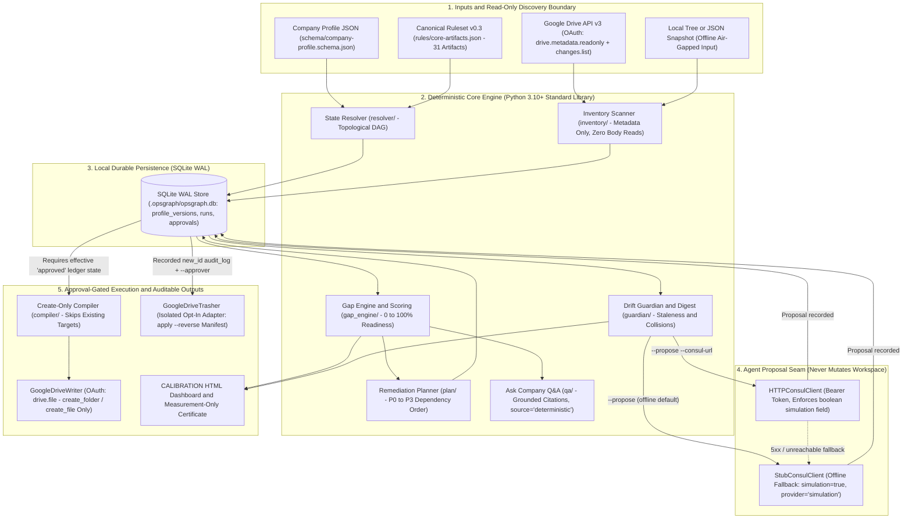

# OpsGraph

[](https://github.com/creova-gif/opsgraph/actions/workflows/ci.yml)
[](LICENSE)

**Deterministic Google Workspace governance compiler with split least-privilege OAuth scopes, a local SQLite WAL human-approval ledger, create-only execution, and explicit deterministic vs. simulation provenance.**

OpsGraph models a startup's operational infrastructure as an auditable **Operating Graph**: given a structured company profile (`schema/company-profile.schema.json`), it resolves which operational artifacts must exist (`rules/core-artifacts.json`), inventories observed workspace metadata without reading document contents (`drive.metadata.readonly`), scores readiness gaps, gates remediation behind an append-only SQLite approval ledger, compiles canonical folder taxonomies and document stubs via create-only operations (`drive.file`), and monitors continuous operational drift.

---

## Implementation Status

> **Epistemic Transparency:** Every subsystem below is categorized according to what executes in code today and is verified by the 16 automated test suites (`127` tests across Python 3.10–3.14 in `.github/workflows/ci.yml`). OpsGraph never claims legal or regulatory compliance; its certificate attests to an empirical point-in-time workspace measurement.

| Subsystem | Status | Implementation & Verification Evidence |
| :--- | :--- | :--- |
| **State Resolver (`resolver/`)** | **Implemented & Verified** | Evaluates `company-profile.schema.json` against 31 governed artifacts (`rules/core-artifacts.json` v0.3) with topological `depends_on` ordering and cycle detection (`resolver/test_resolver.py`) |
| **Workspace Metadata Scanner (`inventory/`)** | **Implemented & Verified** | Scans local trees, JSON snapshots, and live Google Drive API via `drive.metadata.readonly` with exponential backoff (`403`/`429`) and incremental `changes.list` page tokens (`inventory/test_drive_source.py`) |
| **SQLite WAL Store & Approval Ledger (`store/`)** | **Implemented & Verified** | Single-file SQLite (`PRAGMA journal_mode=WAL`, `foreign_keys=ON`) storing schema-validated versioned profiles, immutable run history, and an append-only human approval ledger (`store/test_store.py`) |
| **Gap Engine & Placement Policy (`gap_engine/`)** | **Implemented & Verified** | Computes required-vs-observed diffs, scratch/archive placement flags, domain scorecards, and a 0–100% Infrastructure Readiness Score (`gap_engine/test_gap_engine.py`, `test_matching.py`) |
| **Remediation Planner (`plan/`)** | **Implemented & Verified** | Orders actionable gaps into `P0` critical-path through `P3` phases respecting topological artifact dependencies (`plan/test_planner.py`) |
| **Grounded Ask Company Q&A (`qa/`)** | **Implemented & Verified** | Deterministic intent + token retrieval over resolved/gap/guardian state with explicit citations and `source="deterministic"` provenance (`qa/test_answerer.py`) |
| **Non-Destructive Compiler & Drive Writer (`compiler/`)** | **Implemented & Verified** | Materializes 12 canonical root folders, versioned `CO-001` Master Document Register (CSV/JSON), template stubs, create-only `DriveWriteBackend` (`drive.file`), and isolated `DriveTrashBackend` reversal (`compiler/test_compiler.py`, `test_drive_apply.py`) |
| **Drift Guardian & Delta Digest (`guardian/`)** | **Implemented & Verified** | Detects stale review dates, unowned files, duplicate collisions, and unindexed docs; diffs consecutive runs for escalations and score deltas (`guardian/test_guardian.py`, `test_digest.py`) |
| **CALIBRATION Dashboard & Certificate (`dashboard/`, `certificate/`)** | **Implemented & Verified** | Renders standalone single-file HTML readiness dashboards, loopback preview server (`127.0.0.1`), and measurement-only readiness certificates (`dashboard/test_dashboard.py`, `certificate/test_certificate.py`) |
| **Consul v1 HTTP Client (`integrations/consul.py`)** | **Implemented & Verified (Client Seam)** | `HTTPConsulClient` speaks `POST /v1/agent-runs` with bearer auth, idempotency keys, and mandatory `simulation` boolean enforcement over real sockets (`integrations/test_consul.py`, `test_consul_e2e.py`) |
| **Offline Remediation Simulator (`StubConsulClient`, `demo/`)** | **Simulation Mode** | When `--consul-url` is unset or unreachable, `StubConsulClient` emits deterministic templates tagged `simulation=True, provider="simulation"`; `opsgraph demo` runs a 7-moment local sandbox |
| **Live `consul-core` LLM Synthesis Server** | **Roadmap** | Server-side LLM skill execution (`guardian-remediation`, synthesized Mode A Q&A) behind the `consul-core` v1 contract (`docs/architecture/CONSUL_INTEGRATION_CONTRACT.md`) |
| **Automated Weekly Digest Delivery (Slack / Email)** | **Roadmap** | Scheduled webhook/SMTP delivery of `opsgraph digest` run-over-run drift summaries |
| **Microsoft 365 / SharePoint Source Adapter** | **Roadmap** | Read-only Microsoft Graph metadata adapter emitting the normalized `InventorySnapshot` contract |

---

## Problem Statement & Operational Context

Seed to Series A B2B startups (5–50 employees) build product velocity long before they formalize internal company infrastructure. Governance policies, vendor contracts, architecture decision records, onboarding checklists, and incident postmortems accumulate organically across ad-hoc Google Drive folders, personal drives, and abandoned wiki pages.

When an external forcing function arrives — an enterprise buyer's 150-question security review, a SOC 2 readiness kickoff, a Series A data-room request with a 48-hour turnaround, or rapid multi-country hiring — existing categories leave a structural gap:

1. **Compliance Scanners (Vanta, Drata, Secureframe)** automate cloud/IAM control checks for infosec audits, but do not structure or reconcile broader company operating artifacts (corporate registers, board governance, commercial playbooks, HR lifecycle docs) inside the shared drive.
2. **Horizontal Workspaces & Template Packs (Notion, Coda, static Drive kits)** require disruptive team migration or dump dozens of unmaintained static templates that go stale within 90 days and carry zero binding to observed workspace state.
3. **Unconstrained Workspace Automation Scripts** typically demand full `https://www.googleapis.com/auth/drive` read/write/delete permissions, creating an unacceptable blast radius where a bug or hallucination can overwrite, relocate, or trash live legal agreements.

---

## Solution Overview

OpsGraph treats company governance as a **state reconciliation and compilation problem** inside the Google Workspace a startup already uses:

```text
Company Profile -> Required State -> Read-Only Metadata Scan -> Gap & Plan -> Ledger Approval -> Create-Only Compile -> Drift Guardian
```

- **Context-Conditioned Ontology (`rules/core-artifacts.json`):** Models 31 canonical artifacts across Company Control, Governance, Legal/Privacy, Security, Engineering, People, Finance, Commercial, and Operations — conditioned on company stage (`pre_seed`, `seed`, `series_a`), headcount, jurisdiction, business model, and commercial triggers.
- **Metadata-Only Discovery (`inventory/`):** Evaluates filenames, canonical IDs, folder placement, modification timestamps, and document ownership without downloading sensitive file payloads.
- **Human-Gated Compilation (`store/` + `compiler/`):** Persists every profile version, scan, gap report, plan, and human approval decision in a local SQLite WAL store before creating missing folder hierarchies, the `CO-001` Master Document Register, and provenance-stamped markdown stubs.
- **Continuous Drift Reconciliation (`guardian/`):** Flags stale policy review cycles, ownerless documents, duplicate file collisions, and run-over-run regressions (`opsgraph digest`).

---

## System Architecture



---

## Engineering Decisions & Security Trade-Offs

Full architectural rationale is recorded in [ADR 0001: Zero-Dependency Python Core, SQLite WAL Persistence, and Non-Destructive v1 Compiler](docs/adr/0001-sqlite-wal-and-non-destructive-compiler.md), [Apply Reversibility](docs/engineering/APPLY_REVERSIBILITY.md), and the [Consul Integration Contract](docs/architecture/CONSUL_INTEGRATION_CONTRACT.md).

### 1. Split Google OAuth Scopes (`drive.metadata.readonly` + `drive.file`) vs. Monolithic `drive` Scope

Most workspace integrations request `https://www.googleapis.com/auth/drive`, granting a single token unrestricted permission to read, modify, move, and permanently delete every file in a user's shared drives. OpsGraph rejects this pattern in favor of **capability-split adapters**:

| Dimension | Monolithic `drive` Scope (Rejected) | OpsGraph Split-Scope Architecture (Chosen) |
| :--- | :--- | :--- |
| **Discovery (`opsgraph scan`)** | Can download confidential contract/board PDF bodies | Uses `drive.metadata.readonly` (`inventory/drive_source.py`); inspects metadata fields only |
| **Execution (`opsgraph apply`)** | Can overwrite, move, or delete pre-existing customer files | Uses `drive.file` (`GoogleDriveWriter`); Google's API restricts access strictly to objects OpsGraph created |
| **Protocol Surface (`DriveWriteBackend`)** | Bidirectional CRUD reconciler | Exposes **only** `create_folder` and `create_file` (`compiler/drive_apply.py`); existing canonical paths emit `action: "skip"` |
| **Reversal (`opsgraph apply --reverse`)** | Requires heuristic state snapshots or backup restores | Separate `DriveTrashBackend` (`GoogleDriveTrasher`) trashes only the exact `new_id` entries recorded in `runs.payload.audit_log`, still within `drive.file` |

**Trade-off:** OpsGraph v1 will not automatically move or delete misplaced legacy files in a messy Drive; instead, `gap_engine/` and `guardian/` surface misplaced or duplicate files as structured remediation items for human action.

### 2. Local SQLite WAL Persistence & Human-Approval Ledger vs. Cloud Postgres

Operational state is stored in a single-file SQLite database (`.opsgraph/opsgraph.db`) configured with `PRAGMA journal_mode=WAL` and `PRAGMA foreign_keys=ON` (`store/store.py`).
- **Why chosen:** Enables instant clean-clone reproducibility, concurrent local reads (running `opsgraph serve` while executing CLI queries), ACID run logging, and an append-only `approvals` ledger (`approved` / `rejected` decisions per `artifact_id` or `*` wildcard) with zero Docker or cloud database setup.
- **Default-on governance:** `opsgraph init` sets `governance.require_compile_approval = true` by default so `compile` and `apply` fail closed on unapproved artifacts.
- **Trade-off:** Designed for single-tenant CLI execution, CI drift gates, and concierge workspace installs rather than high-concurrency multi-tenant SaaS writes.

### 3. Explicit Provenance (`source="deterministic"` & Mandatory `simulation` Flag) vs. Opaque AI Wrappers

Governance software loses credibility when rule templates or offline stubs are presented as live LLM reasoning or compliance sign-off:
- **Grounded Q&A (`qa/answerer.py`):** Every `opsgraph ask` response carries `source: "deterministic"`, explicit citations (`CO-001`, `domain:Security`, `event:...`), and an honest `confidence: "low"` fallback when a query falls outside structured state.
- **Wire-Level Simulation Enforcement (`integrations/consul.py`):** `HTTPConsulClient` requires every `POST /v1/agent-runs` JSON response to include a boolean `simulation` key — raising `ConsulUnavailable` if omitted so canned server responses can never silently pass as live model inference. Offline fallbacks via `StubConsulClient` always tag `simulation=True` and `provider="simulation"`, rendered visibly as `[simulation]` vs. `[real]`.
- **Measurement-Only Certificates (`certificate/generator.py`):** Verbatim attestation clarifies that the readiness score measures structural artifact presence against `rules/core-artifacts.json`, never legal compliance.

### 4. Zero-Dependency Python Standard Library Core

All 15 packages run strictly on Python 3.10–3.14 `stdlib` (`sqlite3`, `json`, `urllib.request`, `http.server`, `argparse`, `dataclasses`, `unittest`). Optional Google API packages (`google-api-python-client`, `google-auth`, `google-auth-oauthlib`) are isolated in `pip install -e ".[drive]"`. This eliminates transitive supply-chain churn and keeps the entire 127-test suite executing in **< 3 seconds**.

---

## Technology Stack & Repository Layout

- **Runtime:** Python `3.10` – `3.14` (zero mandatory third-party dependencies)
- **Persistence:** SQLite 3 (`WAL` journal mode, `foreign_keys=ON`, custom JSON Schema Draft 2020-12 validator in `store/validate.py`)
- **Optional Cloud SDK (`[drive]`):** `google-api-python-client>=2.100.0`, `google-auth>=2.30.0`, `google-auth-oauthlib>=1.2.0`
- **Visual System:** Single-file HTML5/CSS3 reports built from `DESIGN.md` and `docs/design/tokens.json` (`CALIBRATION` aesthetic)

```text
opsgraph/
├── opsgraph_cli.py          # Unified CLI entrypoint (`opsgraph` console script, 16 subcommands)
├── onboarding/              # `opsgraph init` schema-valid profile builder + unanswered provenance
├── schema/                  # `company-profile.schema.json` (canonical onboarding input contract)
├── rules/                   # `core-artifacts.json` (31 governed artifacts + placement policy v0.3)
├── resolver/                # Deterministic state resolver + topological dependency ordering
├── inventory/               # Local, snapshot, and Google Drive (`drive.metadata.readonly`) scanners
├── store/                   # SQLite WAL profile versioning, run history, and approval ledger
├── gap_engine/              # Required-vs-observed analyzer, matching rules, and domain scorecards
├── plan/                    # P0–P3 dependency-ordered remediation planner
├── qa/                      # Deterministic `Ask Company` Q&A engine with citations
├── compiler/                # Create-only local compiler + `drive.file` writer & isolated reverser
├── guardian/                # Drift/staleness auditor + run-over-run `digest` delta engine
├── integrations/            # `consul-core` v1 `HTTPConsulClient` + `StubConsulClient` simulator
├── dashboard/               # Single-file CALIBRATION HTML readiness dashboard & loopback server
├── certificate/             # Single-file HTML Operational Readiness Certificate generator
├── demo/                    # 7-moment offline end-to-end simulation runner
├── examples/                # Bundled Pre-Seed, Seed B2B SaaS, Series A profiles & Drive snapshot
└── docs/                    # ADRs (`docs/adr/`), contracts (`architecture/`), reversibility (`engineering/`)
```

---

## Prerequisites & Quickstart

**Prerequisites:** Python `3.10` or newer and `git`. No API keys, cloud credentials, or external databases are needed for the core offline workflow.

### 1. Clean-Clone Install

```bash
git clone https://github.com/creova-gif/opsgraph.git
cd opsgraph
python3 -m venv .venv && source .venv/bin/activate
pip install -e .            # Core CLI (zero third-party dependencies)
pip install -e ".[drive]"   # Optional: live Google Drive API support
```

### 2. Run the Complete Stateful Governance Loop (Under 60 Seconds)

```bash
# 1. Initialize and persist a versioned company profile (enables approval gate by default)
opsgraph init --name "Acme Cloud Technologies, Inc." --domain acmecloud.io \
  --stage seed --headcount 14 --output profile.json --save

# 2. Scan workspace metadata snapshot and record to the SQLite WAL store
opsgraph scan --snapshot examples/sample-drive-inventory.json \
  --company-id acmecloud-io --record

# 3. Compute the Gap Report, Remediation Plan, and Grounded Q&A from stored state
opsgraph gap --company-id acmecloud-io --record
opsgraph plan --company-id acmecloud-io --record
opsgraph ask "what is our readiness score?" --company-id acmecloud-io --format json

# 4. Record human approval in the SQLite ledger and compile governed taxonomy + templates
opsgraph approve acmecloud-io '*' --approver "Jane Doe (VP Ops)" --note "Initial Seed baseline"
opsgraph compile --company-id acmecloud-io --require-approval --target ./workspace_compiled --record

# 5. Run Drift Guardian (with offline simulation proposals) and render CALIBRATION artifacts
opsgraph guardian --company-id acmecloud-io --propose --record
opsgraph dashboard --company-id acmecloud-io --output dashboard.html
opsgraph certificate --company-id acmecloud-io --approver "Jane Doe (VP Ops)" --output certificate.html
opsgraph status acmecloud-io
```

---

## Configuration & Environment Variables

OpsGraph intentionally passes workspace and credential paths via explicit CLI flags rather than ambient global environment variables so read-only (`drive.metadata.readonly`) and create-only (`drive.file`) credentials never mix across invocations. See [`.env.example`](.env.example).

| Variable / Flag | Scope | Default | Behavior & Fail-Closed Semantics |
| :--- | :--- | :--- | :--- |
| `OPSGRAPH_CONSUL_TOKEN` | Env var (`guardian --propose`) | `""` (unset) | Sent as `Authorization: Bearer <token>` when `--consul-url` is set. Unauthenticated/unreachable endpoints raise `ConsulUnavailable` and fall back to `[simulation]`. |
| `--db <path>` | All stateful CLI commands | `.opsgraph/opsgraph.db` | Path to local SQLite WAL store; auto-initializes schema with `foreign_keys = ON`. |
| `--credentials <path>` | `scan --drive`, `apply` | `None` (required for live Drive) | Path to OAuth `client_secret.json` (installed-app flow) or Workspace `service_account.json`. Fails closed if missing. |
| `--token <path>` | `scan --drive`, `apply` | `None` | Local OAuth user token cache path; keep separate token files for read (`scan`) vs. write (`apply`) scopes. |
| `--impersonate <email>` | `scan --drive`, `apply` | `None` | Workspace admin email for domain-wide delegated Service Accounts. |
| `--state <path>` | `scan --drive` | `None` | Persists Google Drive `changes.list` `startPageToken` for incremental metadata delta scans. |
| `--host` / `--port` | `opsgraph serve` | `127.0.0.1:8080` | Binds the interactive dashboard preview server to loopback only by default. |

---

## Local Testing & Verification

OpsGraph ships **16 colocated `unittest` suites** (`127` tests) covering topological resolution, cycle warnings, naive/UTC timestamp coercion, scratch/archive placement policies, Google Drive `429`/`403` retry backoff, incremental `changes.list` merging, create-only protocol enforcement, reversal manifests, SQLite WAL versioning/approvals, and live-socket `consul-core` contract tests.

```bash
# 1. Bytecode & syntax check across all 15 packages + CLI
python3 -m compileall -q certificate compiler dashboard demo gap_engine guardian \
  integrations inventory onboarding plan qa resolver rules schema store opsgraph_cli.py

# 2. Run all 16 unit and E2E test suites (~2.7s)
python3 -m unittest discover -s . -p 'test_*.py' -v

# 3. Stateless fixture smoke check
python3 opsgraph_cli.py gap examples/seed-b2b-saas.json examples/sample-drive-inventory.json --format json
```

CI (`.github/workflows/ci.yml`) runs these checks plus an isolated `/tmp` wheel installation and full SQLite WAL lifecycle smoke test across **Python 3.10, 3.12, and 3.14** on every push and pull request.

---

## CLI & Programmatic Usage Examples

### Live Google Drive Discovery (`drive.metadata.readonly`)

```bash
# Full initial metadata scan + incremental token checkpoint
opsgraph scan --drive \
  --credentials /secure/creds/oauth_client_secret.json \
  --token /secure/creds/token_readonly.json \
  --state .opsgraph/drive_changes_state.json \
  --domain acmecloud.io \
  --company-id acmecloud-io \
  --record
```

### Approval-Gated Google Drive Apply & Deterministic Reversal (`drive.file`)

```bash
# 1. Dry-run diff against recorded snapshot (default — writes nothing to Drive)
opsgraph apply --company-id acmecloud-io

# 2. Execute approved plan Steps from a recorded `plan` run (#3)
opsgraph apply --company-id acmecloud-io --from-plan 3 \
  --credentials /secure/creds/oauth_client_secret.json \
  --token /secure/creds/token_drive_file.json \
  --approver "Jane Doe" \
  --execute --record

# 3. Inspect recorded `new_id` write manifest or reverse a specific apply run (#5)
opsgraph history --run-id 5
opsgraph apply --reverse 5 \
  --credentials /secure/creds/oauth_client_secret.json \
  --token /secure/creds/token_drive_file.json \
  --approver "Jane Doe" \
  --execute --record
```

### Grounded Q&A Provenance Output (`opsgraph ask --format json`)

```json
{
  "question": "what is our readiness score?",
  "text": "Infrastructure readiness is 31.2% (Acme Cloud Technologies, Inc., scanned 2026-10-20 18:00 UTC). Weakest domain: Legal / Privacy / Compliance at 0.0%. Strongest: People at 69.1%. 16 artifacts missing, 6 stale, 13 immediate blockers.",
  "citations": [
    "domain:Legal / Privacy / Compliance",
    "domain:People"
  ],
  "confidence": "high",
  "intent": "score",
  "source": "deterministic"
}
```

### Python Library API

```python
import json
from pathlib import Path
from gap_engine.analyzer import GapAnalyzer
from inventory.scanner import WorkspaceScanner
from resolver.resolver import StateResolver

profile = json.loads(Path("examples/seed-b2b-saas.json").read_text(encoding="utf-8"))
snapshot = WorkspaceScanner().load_snapshot(Path("examples/sample-drive-inventory.json"))

resolution = StateResolver().resolve(profile)
gap_report = GapAnalyzer().analyze(resolution, snapshot)
print(f"{gap_report.company_name}: {gap_report.infrastructure_score}% ({len(gap_report.immediate_blockers)} P0 blockers)")
```

---

## Security & Privacy Posture

- **No Raw Content Ingestion:** Inventory scans inspect Drive object metadata only; document bodies are never downloaded or sent to external LLM APIs.
- **Create-Only Compiler Surface:** `DriveWriteBackend` structurally omits `delete`, `move`, `rename`, and `update`. Reversal is isolated in `DriveTrashBackend` (`apply --reverse`) and restricted by `drive.file` to objects created by OpsGraph.
- **Least-Privilege CI & Dependency Hygiene:** GitHub Actions workflows run with `permissions: contents: read`, and `.github/dependabot.yml` monitors `pip` and `github-actions` weekly.
- **Vulnerability Disclosure:** Report security issues privately to **creativeinnovationspace@gmail.com** per [SECURITY.md](SECURITY.md).

---

## Known Limitations & Roadmap

1. **No Automatic Relocation of Legacy Files in v1:** By design, OpsGraph v1 never moves, renames, or deletes pre-existing messy files in Google Drive; operators relocate flagged `MISPLACED_FILE` or `DUPLICATE_COLLISION` items manually or via future quorum-gated v2 workflows.
2. **Metadata-Heuristic Matching:** Artifact matching (`gap_engine/matching.py`) matches canonical IDs (`CO-001`, `SE-001`), register entries, and normalized title tokens rather than reading full document prose; unconventional filenames without a `CO-001` register entry may be flagged as `MISSING` + `UNINDEXED_FILE` until registered.
3. **Single-Workspace Local SQLite Store:** `.opsgraph/opsgraph.db` targets single-tenant CLI runs, CI pipelines, and concierge onboarding rather than multi-tenant cloud SaaS concurrency.
4. **External `consul-core` Server Not Bundled:** `HTTPConsulClient` implements the complete client contract (`docs/architecture/CONSUL_INTEGRATION_CONTRACT.md`), while local runs without a live `consul-core` endpoint execute `StubConsulClient` (`simulation=True`).

---

## Contributing & License

- **Contributing:** See [CONTRIBUTING.md](CONTRIBUTING.md), [AGENTS.md](AGENTS.md), and [Code of Conduct](CODE_OF_CONDUCT.md).
- **Release History:** Tracked in [CHANGELOG.md](CHANGELOG.md).
- **License:** Distributed under the **Apache License 2.0**. See [LICENSE](LICENSE).
- **Contact:** Open an issue on [GitHub](https://github.com/creova-gif/opsgraph/issues) or email **creativeinnovationspace@gmail.com**.
