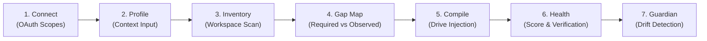

# 2-Minute Demo Script & Storyboard — Evidence Room (04-Demo)

> **Source:** Playbook Section 9 (Demo Design)  
> **Target Length:** Under 2 minutes.  
> **YC Principle:** No cinematic branding, background music, or slideware. Show real software executing against a Google Workspace tenant.

---

## The 7 Demo Moments

---

### Moment 1: Connect (0:00 – 0:15)
* **Screen:** Clean UI with "Connect Google Workspace" button. Shows granular read/write Google Drive scopes.
* **Voiceover:** *"Most startups run on Google Workspace. Rather than forcing founders to migrate to another wiki or new workspace, Company OS connects directly via standard Google APIs."*
* **YC Signal:** Real product, not slideware; respects existing customer workflows.

---

### Moment 2: Profile (0:15 – 0:30)
* **Screen:** 60-second onboarding form (`company-profile.schema.json`): Stage (Series A), Headcount (18 FTE), Jurisdiction (Delaware / California), Industry (B2B SaaS / FinTech), Trigger (Fortune 500 enterprise deal + SOC 2 request).
* **Voiceover:** *"Next, the founder answers four key context questions. Company OS models what operational infrastructure a company at this exact stage and regulatory context is required to possess."*
* **YC Signal:** Context-driven, deterministic model rather than generic template dumping.

---

### Moment 3: Inventory (0:30 – 0:45)
* **Screen:** Terminal / Dashboard scanning the connected Drive. Outputs: 412 files scanned, 42 folders, 18 dangling documents without owners, 6 conflicting versions of the "Information Security Policy".
* **Voiceover:** *"Company OS runs an inventory of the actual workspace—identifying scattered documents, outdated dates, duplicate drafts, and ownerless files."*
* **YC Signal:** Understands messy reality; shows instant analytical capability.

---

### Moment 4: Gap Map (0:45 – 1:05)
* **Screen:** Interactive side-by-side Gap Report: Required State (31 Core Artifacts) vs Observed State (8 present, 4 outdated, 19 missing). Highlights red blockers for the upcoming Enterprise Deal.
* **Voiceover:** *"This is the core insight: the Gap Map. We don't just dump 50 empty templates. We show exactly what is missing, why it is required for their enterprise deal, and what needs approval."*
* **YC Signal:** The core secret: Required-state model vs reality.

---

### Moment 5: Compile (1:05 – 1:25)
* **Screen:** Founder clicks "Approve & Compile". The system executes via Google Drive API: creates the canonical folder structure (`00_GOVERNANCE`, `01_OPERATIONS`, `02_SECURITY`, etc.), creates the Master Document Register spreadsheet, and stamps versioned policies with provenance metadata.
* **Voiceover:** *"With one click, Company OS compiles the approved infrastructure directly into their Google Drive. It numbers documents canonically, assigns functional owners, and links evidence registers."*
* **YC Signal:** Concrete action and tangible output, not advisory analysis only.

---

### Moment 6: Health Score (1:25 – 1:40)
* **Screen:** Before-and-after readiness gauge moves from 26% (Critical Gaps) to 92% (Enterprise Ready). Unresolved items (e.g., signing a specific DPA) are isolated in an exception queue.
* **Voiceover:** *"In under five minutes, the startup goes from unorganized files to an enterprise- and investor-ready operating infrastructure, with a clear queue for the founder's remaining signatures."*
* **YC Signal:** Quantifiable, high-relief outcome.

---

### Moment 7: Company Guardian (1:40 – 2:00)
* **Screen:** A simulated post-install drift event occurs: an engineer uploads an unindexed vendor contract into a personal drive folder, and a security policy reaches its 90-day review date. The Guardian alert appears in Slack/Email with a single-click "Reconcile" action.
* **Voiceover:** *"Finally, Company OS doesn't rot. The Company Guardian continuously monitors the workspace for unassigned files, policy drift, and stale evidence—keeping the company continuously ready."*
* **YC Signal:** Justifies ongoing SaaS recurring revenue (retention & expansion).
