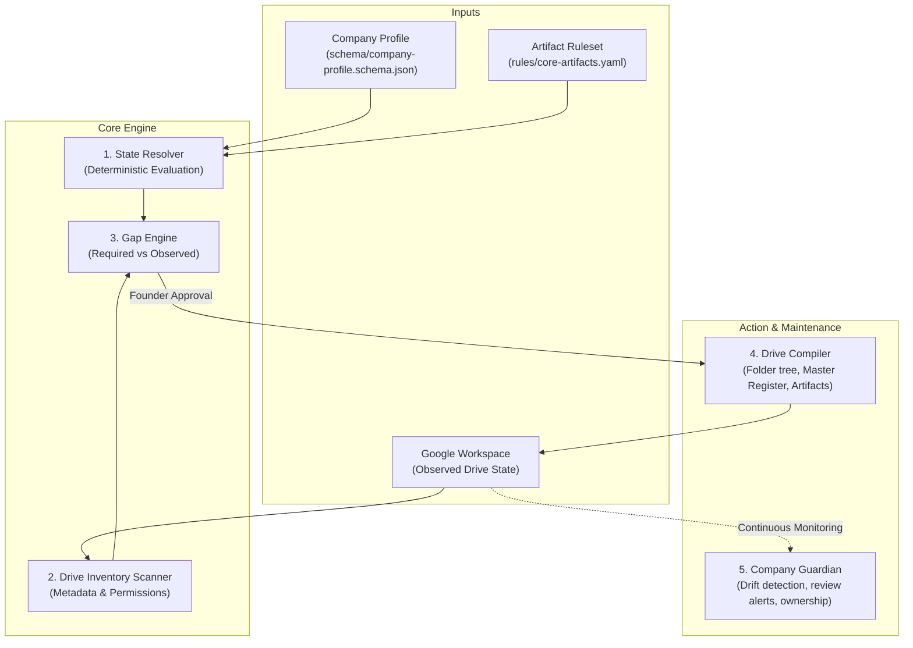

# Product Architecture & Engineering Backlog — Evidence Room (05-Product)

> **Source:** `README.md`, Blueprint Section 5 & 10  
> **Core Loop:** `Profile -> Required State -> Workspace Inventory -> Gap Report -> Compile (approved) -> Guardian`

---

## 1. System Architecture

---

## 2. Core Modules & Responsibilities

1. **Company Profile Schema (`schema/company-profile.schema.json`):** Captures stage (Pre-seed to Series A), team size, legal jurisdictions, business model (B2B SaaS, Marketplace, FinTech), active triggers, and regulatory frameworks (SOC 2, HIPAA, GDPR).
2. **Artifact Rules Engine (`rules/core-artifacts.yaml`):** Codifies 31 core operational artifacts across Governance, Security, People/HR, Commercial, and Finance. Defines condition triggers, canonical file naming, numbering formats, and refresh intervals.
3. **Drive Inventory Engine (Read-only):** Connects via Google Drive API to scan folder hierarchies, file metadata, MIME types, creation/modification dates, and ownership without inspecting sensitive document payloads unnecessarily.
4. **Gap Analysis Engine:** Evaluates the difference between the computed Required State and the scanned Observed State. Categorizes gaps into Missing, Outdated, Duplicated, or Unowned.
5. **Compiler Module:** Executes approved additions. Writes structured folder hierarchy, initializes the Google Sheet Master Document Register, and creates drafted policies stamped with metadata.
6. **Company Guardian:** Scheduled background agent that monitors drive activity for operational drift (e.g., stale review dates, unindexed contracts, missing file owners).

---

## 3. Product Backlog (Pre-Application Sprint)

| Priority | Feature / Work Item | Status | Technical Deliverable |
|:---:|---|:---:|---|
| **P0** | **State Resolver Engine** | **Completed** | Evaluates `company-profile.json` + `core-artifacts.json` -> outputting required artifacts with reasons, owner resolution, and topological order. Unit tested in `resolver/test_resolver.py`. |
| **P0** | **Drive Inventory Prototype** | **Completed** | Read-only Google Drive & local metadata scanner fetching folder hierarchy, file metadata, and timestamps in `inventory/scanner.py`. |
| **P0** | **Gap Analysis Engine** | **Completed** | Markdown & JSON output comparing required vs observed artifacts; computes 0–100% Company Infrastructure Score in `gap_engine/analyzer.py`. |
| **P1** | **Compiler Execution** | **Completed** | Idempotent compiler creating 12 canonical folders, Master Register (CSV/JSON), and governed templates with provenance headers in `compiler/compiler.py`. |
| **P1** | **Company Guardian Prototype** | **Completed** | Continuous background drift engine detecting unowned files, stale reviews, and collisions; outputs weekly Health Digest in `guardian/guardian.py`. |
| **P1** | **End-to-End Demo Runner** | **Completed** | 7-moment live simulation runner (`bin/company-os demo` / `demo/run_demo.py`) matching YC demo script. |
| **P2** | **Slack / Email Digest** | Backlog | Weekly digest to founder highlighting pending operational items and drift warnings. |
