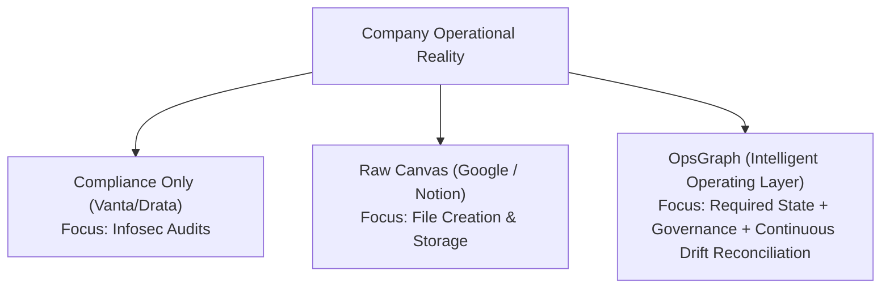

# Competitive Landscape & Category Research — Evidence Room (06-Research)

> **Source:** Playbook Section 13 (Competitive Answer Discipline)  
> **Rule:** Name competitors directly. Never claim "we have no competitors." Do not attack incumbents; define system boundaries.

---

## 1. Competitive Comparison Matrix

| Competitor / Alternative | Category / Primary Job | Core Strengths | Where They Stop / The Boundary | Why Startups Choose OpsGraph |
|---|---|---|---|---|
| **Vanta / Drata / Secureframe** | Compliance Automation (SOC 2, ISO 27001, HIPAA) | Exceptional audit workflows, automated technical evidence collection (AWS/GitHub integrations). | Only care about compliance. Do not structure general governance, board decks, hiring registers, IP assignments, or general operational state. | Startups need a complete operational system for enterprise sales, fundraising, and hiring—not just an infosec audit tool. |
| **Google Workspace / Microsoft 365** | Horizontal Productivity Canvas | Massive distribution, universal file creation and real-time collaboration. | Zero semantic opinion on what an early-stage company must own. They provide empty buckets that rapidly devolve into chaotic digital landfills. | We turn the empty canvas they already pay for into an organized, governed operating system. |
| **Notion / Coda / Slite** | Wiki & Document Workspaces | Beautiful UI, internal documentation, team wikis, basic AI writing assistants. | Requires full company migration. Unstructured; does not enforce deterministic required state, canonical registers, or enterprise audit trails. | Founders do not want to force their team to abandon Google Docs/Drive; OpsGraph runs natively in their existing stack. |
| **Fractional COOs & Ops Consultants** | Manual Services ($5k–$15k+) | High context, bespoke advisory, human relationship. | Static one-time delivery; exorbitant cost; results rot into irrelevance within 90 days. | 10x faster installation (48 hours vs 6 weeks), 1/5th the cost, and continuously maintained by an active Guardian. |

---

## 2. Category Boundary Definition

---

## 3. RFS & Industry Trend Alignment

1. **AI-Native Compliance & Operating Infrastructure (YC RFS):** Compliance is just one filtered view of a company's total operational graph. By establishing the broader required-state model first, compliance certification becomes an effortless derivative export.
2. **From Tools to Autonomous Maintenance:** The industry is moving from passive storage (Drive folders) to active, self-reconciling workspaces where AI acts as the organization's automated librarian and chief of staff.
